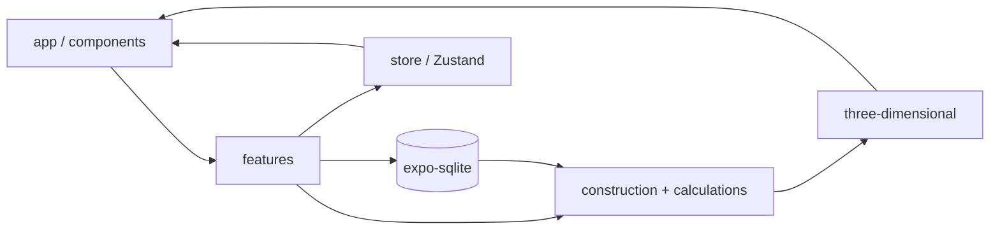

# WallPlan — Phase 1: Projektanalyse und technische Architektur

**Repository:** [KCLK08/WallPlan](https://github.com/KCLK08/WallPlan)  
**Stand:** 10. November 2026  
**Branch zum Zeitpunkt der Analyse:** `main`  
**Commit:** `a3e458d` („Initial commit“)

Dieses Dokument hält das Ergebnis von Phase 1 fest. Es beschreibt den Ist-Zustand, die geplante Architektur und die offene 3D-Entscheidung. Es enthält keine Implementierung.

Phase 2 (Projektgerüst, Abhängigkeiten, 3D-Spike) startet erst nach ausdrücklicher Freigabe.

---

## 1. Zustand des bestehenden Projekts

Das Repository befindet sich im Greenfield-Zustand nach dem Initial-Commit.

| Aspekt | Befund |
|--------|--------|
| Dateien | Nur `README.md` (Inhalt: `# WallPlan`) |
| Expo / React Native | Nicht vorhanden (kein `package.json`, kein `app.json` / `app.config`) |
| TypeScript | Nicht vorhanden |
| Expo Router | Nicht vorhanden |
| Komponenten / Features | Keine |
| Datenhaltung | Keine |
| Startfähigkeit | Die App ist nicht startbar. Es gibt keine Laufzeitumgebung. |

**Fazit:** WallPlan ist als GitHub-Projekt angelegt. Die Anwendungsschicht fehlt vollständig. Phase 2 beginnt mit dem Expo-Scaffolding. Es gibt keine bestehenden Inhalte, die überschrieben werden müssten.

---

## 2. GitHub-Verbindungsstatus

Prüfung am 10. November 2026:

| Prüfpunkt | Ergebnis |
|-----------|----------|
| Remote | `origin` zeigt auf `https://github.com/KCLK08/WallPlan` (fetch und push) |
| Aktiver Branch | `main` |
| Synchronisation | Lokales `HEAD` und `origin/main` sind identisch (`a3e458d`) |
| Uncommittete Änderungen | Keine (`working tree clean`) |
| Weitere Branches | Nur `main` (lokal und remote) |

Die GitHub-Verbindung ist korrekt. Es sind keine Einrichtungsschritte nötig.

### Arbeitsweise ab Phase 2

- `main` bleibt der stabile Hauptbranch und nimmt nur geprüfte Pull Requests auf.
- Entwicklungsphasen laufen auf eigenen Feature-Branches.
- Commits beschreiben den fachlichen Inhalt der Änderung.
- Abgeschlossene Phasen werden per Pull Request übernommen.
- Keine ungeprüften Änderungen direkt in `main`.
- Keine Force-Pushes.
- Kein neues Repository.

---

## 3. Vorhandene Projektstruktur

Aktuell:

```text
WallPlan/
├── .git/
└── README.md
```

Es gibt keine App-Struktur. Die Struktur in Abschnitt 6 ist die Zielplanung und berücksichtigt die Konvention von Expo Router: der Ordner `app/` ist für das dateibasierte Routing reserviert.

---

## 4. Technische Ausgangslage

| Technologie | Ist-Zustand | Soll |
|-------------|-------------|------|
| Expo | — | Ja. SDK erst nach dem 3D-Spike festlegen (Abschnitt 7). |
| React Native | — | Ja |
| TypeScript | — | Ja, `strict` empfohlen |
| Expo Router | — | Ja, file-based routing |
| Zustand | — | Ja, für UI- und Editorzustand |
| Expo SQLite | — | Ja, für Projekte, Konstruktionen und Katalog |
| 3D | — | Echte Geometrie, kompatibel mit Expo Go |
| Backend / Login / Cloud | — | Ausgeschlossen |
| Offline | — | Vollständig lokal |

### SDK-Orientierung

Die aktuelle Expo-Dokumentation führt Module wie `expo-gl` und `expo-sqlite` im Kontext neuerer SDK-Generationen. Expo Go verlangt eine exakte Übereinstimmung zwischen der SDK-Version des Projekts und der installierten Expo-Go-App.

Für den Phase-2-Spike ist **Expo SDK 54** der konservative Startpunkt: die Go-Verfügbarkeit ist breit, und `@react-three/fiber` 9.4.2 enthält einen Kompatibilitätsfix für SDK 54. Die endgültige SDK-Version wird an die Expo-Go-Version der Zielgeräte gebunden und danach dokumentiert. Ein späteres Anheben auf ein neueres, weiterhin Go-kompatibles SDK bleibt möglich.

---

## 5. Empfohlene Architektur

### Prinzipien

1. **Eine Quelle für Konstruktionsdaten.** Ein Domänenmodell in SQLite speist Berechnung und 3D-Erzeugung über dieselben IDs und Maße.
2. **Klare Schichten:**
   - **UI** (`app/`, `components/`): Darstellung und Navigation.
   - **Features:** Anwendungsfälle wie „Wand anlegen“ oder „Seite beplanken“.
   - **Domäne** (`construction/`, `calculations/`, `catalog/`): Regeln, Typen, Katalog.
   - **3D** (`three-dimensional/`): Geometrie aus Domänenobjekten. Keine Fachlogik im Mesh-Code.
   - **Persistenz** (`database/`): Schema, Migrationen, Repositories.
   - **Zustand** (`store/`): Auswahl, Editor-Modus, transienter UI-Zustand.
3. **Offline-first.** Materialdaten und Projekte liegen lokal. Ein späterer Datei-Export oder -Import ist möglich. Ein Cloud-Dienst gehört nicht zum Umfang.

### Datenfluss



Es gibt kein Backend, kein Login und keine Laufzeitabhängigkeit von einem Netz.

---

## 6. Vorgeschlagene Ordnerstruktur

Die Namen bleiben englisch, wie im React-Native-Umfeld üblich. Die Fachdokumentation kann deutsch bleiben.

```text
WallPlan/
├── app/                          # Expo Router: Screens und Layouts
│   ├── _layout.tsx
│   ├── index.tsx                 # Projektliste / Start
│   └── project/
│       └── [projectId]/
│           ├── _layout.tsx
│           ├── index.tsx         # Projektübersicht
│           └── wall/
│               └── [wallId].tsx  # Editor und 3D
├── components/                   # Wiederverwendbare UI
├── features/
│   ├── projects/
│   ├── walls/
│   └── materials/
├── construction/                 # Konstruktionstypen und Defaults
│   ├── types/
│   │   └── metal-stud-partition/
│   └── validators/
├── catalog/                      # Lokaler Materialkatalog
├── calculations/                 # Mengen, Verschnitt, Befestiger
├── three-dimensional/
│   ├── builders/
│   ├── materials/                # Visuelle Three-Materialien
│   └── scene/
├── database/
│   ├── schema.ts
│   ├── migrations/
│   └── repositories/
├── store/
├── types/
├── constants/
├── docs/
│   ├── architecture.md           # später, aus diesem Bericht abgeleitet
│   ├── data-model.md             # später
│   └── PHASE-1-ANALYSE.md        # dieses Dokument
├── assets/
├── app.json oder app.config.ts
├── package.json
├── tsconfig.json
├── .gitignore
├── README.md
└── CHANGELOG.md
```

In Phase 2 entsteht kein generisches Plugin-Framework für Konstruktionstypen. Zuerst gibt es genau einen Typ, `metal_stud_partition`, mit einer kleinen Registrierungsstelle, an der spätere Typen andocken.

`README.md` und `CHANGELOG.md` werden mit dem Scaffolding in Phase 2 angelegt bzw. erweitert. Das Changelog folgt dem Format „Keep a Changelog“.

### `.gitignore`

Beim Scaffolding gilt die Expo-Standardliste, ergänzt um:

- `node_modules/`, `.expo/`, `dist/`
- Schlüssel und Zertifikate (`*.jks`, `*.p8`, `*.p12`, `.env`, `.env.*`)
- generierte native Ordner `ios/` und `android/`, falls Continuous Native Generation genutzt wird
- lokale SQLite-Dateien mit Nutzerdaten (`*.db`, `*.db-journal`)
- Betriebssystemdateien

---

## 7. Gemeinsames Konstruktionsdatenmodell

Das Modell versorgt später sowohl die 3D-Darstellung als auch die Materialberechnung. Jedes Bauteil hat eine eigene ID. Neue Konstruktionstypen kommen als weitere Variante einer Union hinzu, ohne das Wandmodell umzudeuten.

### Identifikation

- Jede Entität trägt `id: string` (UUID v4).
- Elternbezug über `projectId` bzw. die umgebende Konstruktion.
- `updatedAt` (und bei Bedarf `revision`) am Projekt für Migration und Export.

### Kernentitäten

| Entität | Rolle |
|---------|--------|
| Project | Bauvorhaben, Metadaten, Liste der Konstruktionen |
| Construction | Instanz eines Konstruktionstyps (discriminated union) |
| Dimensions | Länge, Höhe; Wanddicke abgeleitet aus Profil und Schichten |
| SideConfiguration | Seite A und Seite B, unabhängig voneinander |
| CladdingLayer | Eine Beplankungsschicht: Materialreferenz, Dicke, Plattentyp, Reihenfolge |
| Framing / Profiles | CW/UW-Profile, Raster, Einfach- oder Doppelständer |
| Insulation | Optionale Dämmung: Dicke und Materialreferenz |
| Opening | Tür, Fenster oder Nische mit Maßen und Position |
| FastenerSpec | Befestigungsmittel, gespeichert oder aus Regeln abgeleitet |
| MaterialRef | Verweis auf einen Eintrag im lokalen Katalog |

### TypeScript-Skizze

Die Skizze ist die geplante Form. Sie ist in Phase 1 nicht als Quellcode angelegt.

```typescript
export type EntityId = string;

export type ConstructionType = 'metal_stud_partition';
// später z. B. 'shaft_wall' | 'lining'

export interface MaterialRef {
  catalogItemId: EntityId;
  sku?: string;
}

export interface CladdingLayer {
  id: EntityId;
  material: MaterialRef;
  thicknessMm: number;
  boardType: 'gypsum' | 'osb' | 'other';
}

export interface SideConfiguration {
  side: 'A' | 'B';
  layers: CladdingLayer[]; // außen nach innen
}

export interface InsulationLayer {
  id: EntityId;
  material: MaterialRef;
  thicknessMm: number;
}

export interface Opening {
  id: EntityId;
  kind: 'door' | 'window' | 'niche';
  widthMm: number;
  heightMm: number;
  offsetFromStartMm: number;
  sillHeightMm?: number;
}

export interface MetalStudFraming {
  mode: 'single' | 'double';
  studSpacingMm: number; // z. B. 625
  profileSystemId: EntityId;
  doubleStudGapMm?: number;
}

export interface MetalStudPartitionConstruction {
  id: EntityId;
  type: 'metal_stud_partition';
  name: string;
  lengthMm: number;
  heightMm: number;
  framing: MetalStudFraming;
  sideA: SideConfiguration;
  sideB: SideConfiguration;
  insulation?: InsulationLayer;
  openings: Opening[];
}

export type Construction = MetalStudPartitionConstruction;

export interface Project {
  id: EntityId;
  title: string;
  createdAt: string;
  updatedAt: string;
  constructions: Construction[];
}
```

### Beplankungsvarianten der Metallständer-Trennwand

Die erste vollständig umzusetzende Konstruktion ist die Metallständer-Trennwand. Beide Wandseiten bleiben unabhängig konfigurierbar.

| Variante | Beispiel für Seite A / Seite B |
|----------|--------------------------------|
| 1. Einfache Gipskarton-Beplankung | je eine GK-Schicht, oder nur eine Seite belegt |
| 2. Doppelte Gipskarton-Beplankung | je zwei GK-Schichten |
| 3. OSB + Gipskarton | z. B. Seite A: OSB + GK, Seite B: eine GK-Schicht |
| 4. Doppelständerwand | `framing.mode: 'double'`, Seiten weiterhin unabhängig |

Die Kalkulation liest Länge, Höhe, Schichtanzahl, Öffnungsflächen, Ständerraster und die Normlängen aus dem Katalog. Die 3D-Erzeugung liest dieselben Felder: Wandkörper, Schichtversatz, Öffnungen und bei Doppelständern einen zweiten Profilzug.

### SQLite

Empfehlung für das erste Schema:

- `projects`
- `constructions` mit stabiler `id`, Typ und einer JSON-Spalte für die polymorphe Konstruktion
- `catalog_items`, beim ersten Start aus einem lokalen Seed gefüllt
- `app_meta` mit der Schema-Version

Eine JSON-Spalte hält die Iteration in den frühen Phasen klein. Katalog-Joins und Auswertungen können später teilweise normalisiert werden, ohne die IDs zu ändern. Migrationen laufen lokal und versioniert.

---

## 8. Bewertung der 3D-Technologien

Die Darstellung muss echte, interaktive 3D-Geometrie sein. Eine statische Grafik oder ein gerendertes Bild erfüllt die Anforderung nicht. Die Lösung muss mit der gewählten Expo- und Expo-Go-Version laufen, Android unterstützen und ohne natives Modul auskommen, das Expo Go nicht enthält.

In Phase 1 wird keine Technologie endgültig festgelegt. Die folgende Bewertung ist die Grundlage für den Spike in Phase 2.

### Option A: `expo-gl` + Three.js, direkt oder über `expo-three`

| Kriterium | Bewertung |
|-----------|-----------|
| Expo Go | `expo-gl` / `GLView` ist in Expo Go enthalten (Android, iOS, Web). |
| Android | OpenGL ES, unterstützt. |
| Touch | Möglich, Orbit-Steuerung muss selbst oder über einen kleinen Helper angebunden werden. |
| Performance | Für Trockenbau-Primitive (Kästen, Profile, Schichtversatz) ausreichend. |
| Wartbarkeit | Imperatives Three.js, mehr Boilerplate im Szenenaufbau. |
| Native Module | Nur das Expo-Go-Set. |

Hinweise aus der `expo-three`-Doku: physische Geräte sind stabiler als Simulatoren; Three.js braucht auf Metro oft `global.THREE = THREE`. Zusätzliche 3D-Dateiformate brauchen später eine Metro-`assetExts`-Ergänzung. `expo-three` hinkt bei Three.js-Versionen hinterher; ein direktes Three.js auf `expo-gl` ist deshalb die robustere Variante dieser Option.

### Option B: `expo-gl` + `@react-three/fiber/native`

| Kriterium | Bewertung |
|-----------|-----------|
| Expo Go | Grundsätzlich ja, weil der GL-Kontext von `expo-gl` kommt. |
| Android | Nach den Fixes in `@react-three/fiber` 9.4.x praktikabel. |
| Touch | Über die Event-Anbindung von Fiber. |
| Performance | Vergleichbar mit Option A. |
| Wartbarkeit | Hoch. Eine deklarative Szene passt zum iterativen Wand-Editor. |
| Native Module | Kein zusätzliches natives Modul außerhalb von Expo Go. |
| Risiko | Auf der New Architecture und bestimmten SDK-Ständen gab es leere Views und Laufzeitfehler. Version 9.4.2 behebt unter anderem den SDK-54-Fehler um `expo-file-system` (`Base64` von `undefined`). `@react-three/drei` nur gezielt einsetzen (z. B. Kamera), nicht das gesamte Paket ungeprüft übernehmen. |

### Option C: `react-native-webgpu` + Three.js WebGPU + Fiber

| Kriterium | Bewertung |
|-----------|-----------|
| Expo Go | Nicht unterstützt. Es braucht einen Development Build (`expo prebuild`). |
| Eignung | Widerspricht der harten Expo-Go-Anforderung. |

Diese Option ist für WallPlan ausgeschlossen, solange Expo Go Pflicht bleibt. Sie kann als spätere Alternative dokumentiert bleiben, falls die App auf einen eigenen Development Build wechselt.

### Option D: WebView + Three.js

| Kriterium | Bewertung |
|-----------|-----------|
| Expo Go | Möglich. |
| Touch und Performance | Schwächer, weil UI und Szene über die WebView-Brücke laufen. |
| Wartbarkeit | Zwei Laufzeitumgebungen. |

Nur Reserve, falls die GL-Pipeline auf den Zielgeräten blockiert.

### Option E: 2D oder statische Bilder

Entfällt. Die App soll später echte 3D-Geometrie zeigen.

### Vorläufige Arbeitshypothese

**Primärziel für den Spike:** `expo-gl` + `three` + `@react-three/fiber/native`.  
**Fallback:** dieselbe Mesh-Builder-Schnittstelle, angebunden an einen imperativen Three.js-Renderer auf `expo-gl`, falls Fiber auf den Zielgeräten scheitert.

Der Spike in Phase 2 entscheidet. Vorher werden keine 3D-Bibliotheken dauerhaft ins Projekt genommen.

### Spike (Go / No-Go)

1. Leeres Expo-Projekt mit der gewählten SDK-Version.
2. Ein rotierender Quader mit Touch-Orbit.
3. Test auf physischem Android-Gerät und, falls verfügbar, auf einem iPhone. Simulatoren gelten nicht als alleiniger Nachweis.
4. Dokumentation von SDK, Fiber-Version, Three-Version und dem Stand der New Architecture.

---

## 9. Benötigte Abhängigkeiten

Noch nicht installiert. Installation erst in Phase 2, und nur in dem Umfang, den Scaffolding und Spike brauchen.

### Kern

| Paket | Zweck |
|-------|--------|
| `expo` | SDK und Werkzeuge |
| `react`, `react-native` | Laufzeit, Versionen über Expo |
| `expo-router` | Navigation |
| `typescript`, `@types/react` | Typprüfung |
| `zustand` | Anwendungszustand |
| `expo-sqlite` | Lokale Persistenz, in Expo Go enthalten |
| `expo-gl` | GL-Kontext, in Expo Go enthalten |
| `three` | 3D-Geometrie |
| `@react-three/fiber` | Deklarativer Renderer, Native-Einstieg |
| `expo-asset`, `expo-file-system` | Falls Fiber oder lokale Assets sie brauchen |

### Später, nicht zum Start von Phase 2

- `expo-three`, nur falls der imperative Fallback ohne Fiber gewählt wird
- `expo-crypto` oder eine kleine UUID-Hilfe für IDs
- `zod` zur Prüfung gespeicherter Konstruktionsdaten
- `react-native-gesture-handler` und `react-native-reanimated`, soweit Expo Router sie nicht schon mitbringt

### Nicht vorgesehen

Firebase, Authentifizierung, HTTP-Clients zu eigenen APIs, Cloud-Datenbanken und jede Abhängigkeit, die zum Start der App ein Netz braucht.

---

## 10. Technische Risiken

| Risiko | Auswirkung | Gegenmaßnahme |
|--------|------------|----------------|
| Expo Go und SDK passen nicht zusammen | Projekt öffnet auf dem Gerät nicht | SDK an die installierte Go-Version binden |
| Fiber und New Architecture | Leere Ansicht oder Absturz | Spike vor der Fachimplementierung; Fallback auf imperatives Three.js |
| 3D im iOS-Simulator | Instabil oder leer | Nachweis auf echter Hardware |
| Three.js-Versionsdrift | Build- oder Laufzeitfehler | Eine Three-Version pinnen, `npx expo install` für Expo-Module |
| Kalkulation und 3D driften auseinander | Falsche Mengen oder falsche Darstellung | Ein Domänenobjekt, getrennte Builder, Tests auf Maße |
| Katalog veraltet | Falsche Stückzahlen | Stabile `catalogItemId`, versionierter Seed, Changelog bei Katalogänderungen |
| Viele Wände in einer Szene | Ruckler | Zuerst eine Wand; Instancing erst bei Bedarf |
| Normen und Haftung | Maße werden als verbindlich gelesen | Die App bleibt eine Planungshilfe; eingegebene Maße bleiben prüfbar |

---

## 11. Umsetzungsplan der nächsten Phasen

### Phase 2 — Fundament

Nach Freigabe, ohne Fachlogik der Wand im vollen Umfang:

- Expo-App mit TypeScript und Expo Router anlegen
- `.gitignore`, README und CHANGELOG
- Ordnerstruktur mit schlanken Modulen
- SQLite Schema v1 und ein minimaler Katalog-Seed (Gipskarton, OSB, Profile)
- Zustand für Projektauswahl und aktiven Editor
- 3D-Spike mit Go/No-Go
- Ein Screen für die Projektliste und ein Platzhalter für den Editor

### Phase 3 — Metallständer-Trennwand

- Eingabe von Maßen, Seite A/B und den vier Beplankungsvarianten
- Validierung und Speicherung
- Mesh-Builder für Wand und Öffnungen
- Erste Materialberechnung: Plattenzahl und laufende Meter Profil, mit nachvollziehbaren Regeln

### Phase 4 — Projekte

- Anlegen, ändern und löschen von Projekten
- Mehrere Wände je Projekt
- Optional ein lokaler JSON-Export

### Phase 5 — Vertiefung

- Befestigungsmittel, Verschnitt, Pflege des Katalogs
- Performance, Barrierefreiheit, durchgängige deutsche Oberflächentexte

---

## 12. Ergebnis von Phase 1

| # | Thema | Kurzfassung |
|---|--------|-------------|
| 1 | Projekt | Nur README. Keine App. |
| 2 | GitHub | Verbunden, synchron, Arbeitsbaum sauber. |
| 3 | Struktur | Leer. Zielstruktur steht in Abschnitt 6. |
| 4 | Technik | Vollständiger Neuaufbau auf dem geplanten Expo-Stack. |
| 5 | Architektur | Offline. SQLite und Zustand. Eine Domäne speist Berechnung und 3D. |
| 6 | Ordner | `app/` bleibt dem Router vorbehalten. |
| 7 | 3D | Arbeitshypothese: `expo-gl` + Three.js + Fiber. WebGPU scheidet für Expo Go aus. Entscheidung nach dem Spike. |
| 8 | Abhängigkeiten | Liste in Abschnitt 9. Installation erst in Phase 2. |
| 9 | Risiken | SDK- und Fiber-Spike sind der kritische Pfad. |
| 10 | Nächster Schritt | Phase 2 nach Freigabe. |

In Phase 1 wurden keine Pakete installiert, keine bestehenden Dateien überschrieben und keine Implementierung begonnen.
